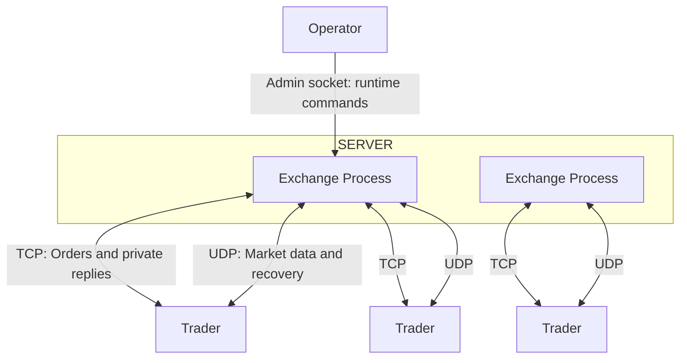

# Exsim

A simple exchange simulator for testing trading strategies with various trading protocal supported.



## Getting Started

From the repository root:

```sh
make -j4 apps
./build/release/exsim_exchanged --config test/fixtures/exchange.conf
```

This builds the exchange and starts one with empty books, waiting for external trading clients. Once ready it prints one JSON line with its ports. Each exchange is its own process: start more with their own config files, and stop one with **Ctrl+C** or `kill <pid>`.

Change a running exchange over the admin socket its config names (`admin_socket = exsim.sock`, next to the config file):

```sh
echo 'phase AAPL halted' | nc -U test/fixtures/exsim.sock
```

See [Running an exchange](./docs/running.md) for the ready line, runtime commands, and config.

To run tests or benchmarks:

```sh
make -j4 test
make -j4 bench
```

## Limitations

- This is a very early alpha, expects bugs.
- We provided only exchange simulator, you have to have your own trader engine.
- Currently support ITCH 5.0, OUCH 4.2, FIX 4.4, iLink 3, and MDP 3.0.

## Further Reading

- [Running an exchange](./docs/running.md)
- [Architecture](./docs/architecture.md)
- [Choices of Data structures and Rationale](./docs/dsa.md)
- [TEST](./test/README.md)
- [BENCHMARK](./benchmark/README.md)
