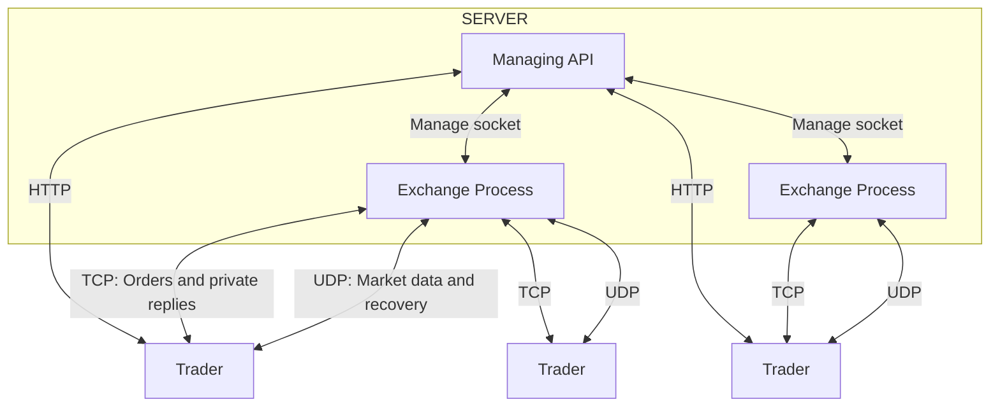

# Architecture

Exsim runs empty exchanges. External trading engines provide every order and all liquidity. A C++ HTTP API manages config files and one C++ process per running exchange. Live exchange state stays in RAM.

## Processes

The API creates, updates, starts, stops, and deletes exchange definitions. It saves full INI configs on disk and reloads them as stopped after restart. It does not restore orders or restart exchanges automatically.

Each exchange runs gateways, matching, market-data publication, and recovery. One event loop sequences commands across sessions. The API stays outside the trading path.

A private UNIX socket carries management commands and status. Start waits for readiness. Stop waits for exit and forces termination if needed. A lost manager connection stops the child exchange.

## Trading connections

OUCH 4.2 runs over SoupBinTCP. FIX 4.4 and CME iLink 3 use separate TCP listeners. All use the same matching engine and books. Public events use ITCH 5.0 over MoldUDP64 or CME MDP 3.0. The [CME profile](ilink-and-mdp.md) defines supported messages and limits. The [FIX gateway notes](fix-gateway.md) cover FIX session policy and limits.

Many traders can connect to one order-entry listener. Each has its own authenticated session. More traders do not require more exchange listener ports.

| Endpoint                | Transport | Purpose                             |
| ----------------------- | --------- | ----------------------------------- |
| Management API          | HTTP/TCP  | Manage exchange processes           |
| OUCH order entry        | TCP       | Orders and private replies          |
| FIX order entry         | TCP       | Orders and private replies          |
| iLink 3 order entry     | TCP       | FIXP/SBE orders and private replies |
| Public feed destination | UDP       | Market data                         |
| ITCH recovery listener  | UDP       | MoldUDP64 retransmission            |
| MDP recovery feeds      | UDP       | Snapshots and instrument definitions |
| MDP replay listener     | TCP       | Authenticated historical packets    |

Use a specific local IPv4 bind address. TCP and recovery listener port zero requests an OS-assigned port. The feed destination needs a nonzero port. Query the API for actual connection details after each start.

Multicast needs a working interface and network path. A unicast feed sends to one destination address. Separate running exchanges cannot share the same feed address and port.

## State and timing

Each process starts with empty books and a fresh managed market-data session identity. Instruments, users, limits, and initial trading phases come from config. The sample starts AAPL in continuous trading.

Matching takes commands and supplied timestamps. It does not read the clock or use randomness. The runtime supplies elapsed timing and trading-day timestamps. A seed alone cannot reproduce external network traffic.

Order storage, session buffers, and recovery history have configured limits. The production matching path uses preallocated storage. Slow consumers and exhausted capacity follow rejection or disconnect rules.

See [data structures and algorithms](dsa.md) for storage and matching costs.

## Disk state

The manager locks its config directory so only one API process can use it. Config writes use atomic replacement and owner-only file permissions. Responses redact passwords; replacement requests need the full original credentials.

Standalone and managed exchanges can write optional journals. Journals do not provide automatic crash recovery, and abrupt termination can lose buffered records.

Books, session state, and feed history disappear when an exchange exits. Recovery covers retained in-memory history. MDP subscribers can join using periodic snapshots and instrument definitions; ITCH subscribers still need earlier feed history.

## Design trade-offs

Simplicity outranks completeness here. The exchange is empty and trading engines connect directly, so each choice below covers what this project needs, not every deployment.

### Why not a library

Each of these is control-plane or test code with a small, fixed need. A dependency would cost more to build and review than the code it replaces. Switch if the need grows past that.

- JSON ([json.hpp](../lib/include/api/json.hpp)): the API reads and writes a few fixed shapes. The parser is strict and bounded, and the same code carries the private manager socket. Switch to a library if the API takes arbitrary client documents or needs schema validation.
- HTTP ([http_message.hpp](../lib/include/api/http_message.hpp)): HTTP/1.1 for a few local clients. The parser rejects what it does not understand and enforces size limits. Switch if the API needs TLS, HTTP/2 or remote access.
- INI config ([config.hpp](../lib/include/server/config.hpp)): flat sections of `key = value`, parsed once at startup. Switch if configs need nesting or includes.
- Test framework ([test.hpp](../test/framework/test.hpp)): self-registering cases with substring filters, no download step, so `make test` works on a bare macOS or Ubuntu toolchain. Switch if tests need fixtures, parameterization or mocks.

### Networking

- Level-triggered poller ([poller.hpp](../lib/include/net/poller.hpp)): epoll on Linux and kqueue on macOS sit behind one interface. Level-triggered readiness repeats until the socket is drained, so the loop can do one `recv` per event and still lose nothing. This avoids the drain-until-`EAGAIN` bookkeeping that edge-triggered needs, where a missed drain stalls a connection. The cost is an extra wakeup when a read leaves data behind. Edge-triggered would help only with many busy connections, which is not the load here.
- No scatter I/O or UDP batching: replies are encoded into one contiguous per-connection buffer and sent with one `send`, so `writev` and `sendmsg` have nothing to gather. Each feed packet is one datagram sent with `sendto`, so `sendmmsg` and `recvmmsg` would only help at packet rates a simulator with a few traders does not reach. Revisit if profiling shows syscalls dominating the feed path.
- IPv4 only, no `SO_REUSEPORT`: the sockets use `AF_INET` and [Ipv4Endpoint](../lib/include/net/socket.hpp), and multicast feeds are IPv4. Each exchange is one process on its own ports, so there is nothing to load-balance across sockets and a clashing bind should fail loudly, which `SO_REUSEPORT` would hide. Add IPv6 if a client needs it; add `SO_REUSEPORT` only if an exchange ever runs several acceptor threads.
- Management API threading: one thread per connection, deliberately. The reasoning is in [http_server.hpp](../lib/include/api/http_server.hpp).

## Limitations

The HTTP API has no authentication and defaults to loopback. Remote traders need a reachable exchange address. Multicast delivery needs a suitable network.

Protocol support is a subset of each specification. iLink uses the pinned version 9 schema with configured party records. MDP supports MBP snapshots and bounded TCP recovery. Exchange state is not restored after a process restart.

Run native processes on macOS or Linux. Active checks cover unit and integration tests. The benchmark suite measures order-book operations and a benchmark-only sharding harness, not the complete exchange service.

See [API specs](api.md), [OpenAPI](openapi.json), [tests](../test/README.md), and [benchmarks](../benchmark/README.md).

Journal flush reaches the OS page cache only, without `fsync` or `fdatasync`. Worker flush requests are asynchronous; `drained()` acknowledges completion. Each start truncates the configured file.
