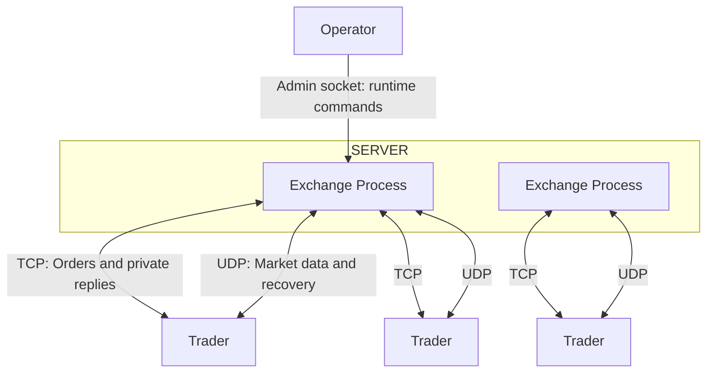

# Architecture

Exsim runs empty exchanges. External trading engines provide every order and all liquidity. Each exchange is one C++ process started from a config file. Live exchange state stays in RAM.

## Processes

The operating system is the process manager. A shell, tmux, systemd, or a test harness starts `exsim_exchanged --config PATH`, reads its ready line for the actual ports, and stops it with SIGINT or SIGTERM. There is no manager process and no HTTP API: its only client would be curl, and every job it did (start, stop, list, restart) is already a process operation.

Each exchange runs gateways, matching, market-data publication, and recovery. One event loop sequences commands across sessions.

An optional Unix domain socket (`admin_socket` in the config) carries runtime commands: phase changes, fault injection, book and status. It is owner-only, runs one line per connection on the event loop, and never blocks it on input. See [running an exchange](running.md).

## Trading connections

OUCH 4.2 runs over SoupBinTCP. FIX 4.4 and CME iLink 3 use separate TCP listeners. All use the same matching engine and books. Public events use ITCH 5.0 over MoldUDP64 or CME MDP 3.0. The [CME profile](ilink-and-mdp.md) defines supported messages and limits. The [FIX gateway notes](fix-gateway.md) cover FIX session policy and limits.

Many traders can connect to one order-entry listener. Each has its own authenticated session. More traders do not require more exchange listener ports.

| Endpoint                | Transport | Purpose                             |
| ----------------------- | --------- | ----------------------------------- |
| Admin socket            | Unix      | Runtime commands from the owner     |
| OUCH order entry        | TCP       | Orders and private replies          |
| FIX order entry         | TCP       | Orders and private replies          |
| iLink 3 order entry     | TCP       | FIXP/SBE orders and private replies |
| Public feed destination | UDP       | Market data                         |
| ITCH recovery listener  | UDP       | MoldUDP64 retransmission            |
| MDP recovery feeds      | UDP       | Snapshots and instrument definitions |
| MDP replay listener     | TCP       | Authenticated historical packets    |

Listeners bind one IPv4 address. TCP and recovery listener port zero requests an OS-assigned port. The feed destination needs a nonzero port. The ready line reports the actual ports after each start.

Multicast needs a working interface and network path. A unicast feed sends to one destination address. Separate running exchanges must not share a feed address and port; nothing checks this across processes.

## State and timing

Each process starts with empty books and a fresh market-data session identity. Instruments, users, limits, and initial trading phases come from config. The sample starts AAPL in continuous trading.

Matching takes commands and supplied timestamps. It does not read the clock or use randomness. The runtime supplies elapsed timing and trading-day timestamps. A seed alone cannot reproduce external network traffic.

Order storage, session buffers, and recovery history have configured limits. The production matching path uses preallocated storage. Slow consumers and exhausted capacity follow rejection or disconnect rules.

See [data structures and algorithms](dsa.md) for storage and matching costs.

## Disk state

Config files belong to the user and are only read at startup. They hold credentials, so keep them owner-only.

Exchanges can write optional journals. Journals do not provide automatic crash recovery, and abrupt termination can lose buffered records.

Books, session state, and feed history disappear when an exchange exits. Recovery covers retained in-memory history. MDP subscribers can join using periodic snapshots and instrument definitions; ITCH subscribers still need earlier feed history.

## Design trade-offs

Simplicity outranks completeness here. The exchange is empty and trading engines connect directly, so each choice below covers what this project needs, not every deployment.

### Why not a library

Each of these is startup or test code with a small, fixed need. A dependency would cost more to build and review than the code it replaces. Switch if the need grows past that.

- JSON: the only JSON is the ready line, one flat object of numbers and IPv4 address strings built by hand in [main.cpp](../src/main.cpp). Nothing in it needs escaping, so a library would add nothing.
- INI config ([config.hpp](../src/server/config.hpp)): flat sections of `key = value`, parsed once at startup. Switch if configs need nesting or includes.
- Test framework ([test.hpp](../test/framework/test.hpp)): self-registering cases with substring filters, no download step, so `make test` works on a bare macOS or Ubuntu toolchain. Switch if tests need fixtures, parameterization or mocks.

### Networking

- Level-triggered poller ([poller.hpp](../src/net/poller.hpp)): epoll on Linux and kqueue on macOS sit behind one interface. Level-triggered readiness repeats until the socket is drained, so the loop can do one `recv` per event and still lose nothing. This avoids the drain-until-`EAGAIN` bookkeeping that edge-triggered needs, where a missed drain stalls a connection. The cost is an extra wakeup when a read leaves data behind. Edge-triggered would help only with many busy connections, which is not the load here.
- No scatter I/O or UDP batching: replies are encoded into one contiguous per-connection buffer and sent with one `send`, so `writev` and `sendmsg` have nothing to gather. Each feed packet is one datagram sent with `sendto`, so `sendmmsg` and `recvmmsg` would only help at packet rates a simulator with a few traders does not reach. Revisit if profiling shows syscalls dominating the feed path.
- IPv4 only, no `SO_REUSEPORT`: the trading and feed sockets use `AF_INET` and [Ipv4Endpoint](../src/net/socket.hpp), and multicast feeds are IPv4. The admin socket is the one `AF_UNIX` listener. Each exchange is one process on its own ports, so there is nothing to load-balance across sockets and a clashing bind should fail loudly, which `SO_REUSEPORT` would hide. Add IPv6 if a client needs it; add `SO_REUSEPORT` only if an exchange ever runs several acceptor threads.
- Admin socket on the event loop ([admin_socket.hpp](../src/server/admin/admin_socket.hpp)): the runtime watches one extra fd, the listener until a client connects and then that client, so admin needs no thread and no lock around the core. One client at a time is enough for an operator; a client gets 5 s to send its line, so one that stalls cannot block the next. The reply is written with a 1 s deadline instead of a write queue.

## Limitations

The admin socket has no authentication beyond its owner-only file mode. Remote traders need a reachable exchange address. Multicast delivery needs a suitable network.

Protocol support is a subset of each specification. iLink uses the pinned version 9 schema with configured party records. MDP supports MBP snapshots and bounded TCP recovery. Exchange state is not restored after a process restart.

Run native processes on macOS or Linux. Active checks cover unit and integration tests. `make bench` measures the matching engine alone; `make bench-wire` measures a running exchange over loopback TCP and UDP only, with no network cards, switches or multicast.

See [running an exchange](running.md), [tests](../test/README.md), and [benchmarks](../benchmark/README.md).

Journal flush reaches the OS page cache only, without `fsync` or `fdatasync`. Worker flush requests are asynchronous; `drained()` acknowledges completion. Each start truncates the configured file.
